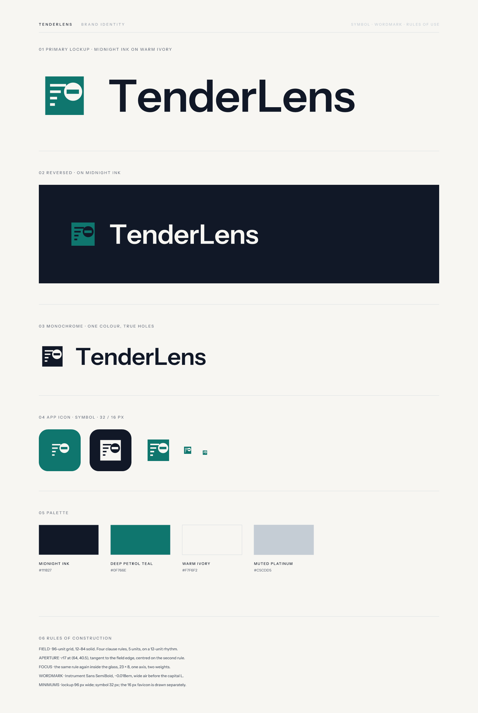

# TenderLens — brand identity

The mark is a **record brought into focus**. A solid field of clause rules is
interrupted by a circular aperture; inside the glass, the same rule reappears
heavier. One line, one axis, two weights — the clause the lens is reading.

It is built to survive a decade: no gradients, no metaphors layered on
metaphors, nothing that depends on colour to be understood.



## The idea, in one sentence

> The rules are the record. The aperture is the reading. The focused rule is the
> clause under examination.

That sentence is the whole system. Every decision below follows from it.

## Files

| File | Use |
| --- | --- |
| `logo/tenderlens-logo-primary.svg` | Default lockup. Midnight Ink wordmark, Deep Petrol Teal symbol, for Warm Ivory or white. |
| `logo/tenderlens-logo-primary-transparent.png` | Same, no background (2400 px wide). |
| `logo/tenderlens-logo-reversed.svg` | For Midnight Ink surfaces. Teal field, ink voids, ivory wordmark. |
| `logo/tenderlens-logo-monochrome.svg` | One colour. Rules and aperture are **true holes**, so it prints on any stock. |
| `logo/tenderlens-symbol.svg` | Standalone mark, 96-unit grid. |
| `icon/tenderlens-app-icon.svg` | Rounded-square app icon (512 units, 112 radius). |
| `icon/tenderlens-favicon.svg` | Master favicon, resolves from 32 px up. |
| `icon/tenderlens-favicon-16.png` | Redrawn for 16 px — do not downscale the master into it. |
| `tenderlens-portal-logo-1024.png` | Square upload asset, 1024 × 1024, 24 KB (limit is 2 MB). |
| `source/build-identity.mjs` | Generator. Every asset above is produced by this file. |
| `source/wordmark.json` | Wordmark outlines extracted from the licensed TTF. |

## Palette

| Name | Hex | Role |
| --- | --- | --- |
| Midnight Ink | `#111827` | Wordmark on light grounds; primary dark surface. |
| Deep Petrol Teal | `#0F766E` | The symbol. The only saturated colour in the system. |
| Warm Ivory | `#F7F6F2` | Page ground. Replaces pure white everywhere. |
| Muted Platinum | `#C5CDD5` | Hairlines, dividers, secondary detail. Never for text. |

No gradients, no additional hues, no tints below 100% except the Platinum
hairlines.

## Construction

**Symbol** — 96-unit grid, field 12–84.
- Four clause rules, 5 units thick, on a 12-unit vertical rhythm, left-aligned at x = 21.
- Aperture: r17 at (64, 40.5) — centred on the axis of the second rule and
  tangent to the field's right and top edges.
- Focus: the rule repeats inside the aperture at 23 × 8, on the same axis.

**Wordmark** — Instrument Sans SemiBold, set as outlines.
- Cap height 45 units against a 72-unit symbol, i.e. the wordmark's cap height is
  62.5% of the symbol box.
- Tracking −0.018 em; the `T` is nudged 0.6% left for optical alignment with the
  field edge; extra air (0.016 em) before the capital `L`.

**Lockup** — symbol, 25-unit gap, wordmark. Ratio 4.6 : 1.

## Clear space and minimums

- Clear space on all sides: the width of one clause rule (5/96 of the symbol) at
  minimum, and never less than the aperture radius when the lockup sits beside type.
- Minimum lockup width: **96 px** (or 24 mm print).
- Minimum symbol: **32 px**. Below that use `favicon-16.png`.
- Do not place the lockup on a photograph, a gradient, or a teal ground — use the
  reversed or monochrome file instead.

## Misuse

Do not recolour the symbol outside the palette · do not re-space the wordmark ·
do not rebuild the lockup at a different symbol-to-wordmark ratio · do not add
effects, shadows, outlines or glows · do not stretch, skew or rotate · do not set
the name in another typeface · do not use the aperture alone as a bullet or icon
without the field.

## Rebuilding

```bash
npm i --no-save @resvg/resvg-js
node brand/source/build-identity.mjs   # reads ./fonts/wordmark.json next to it
```

The script writes into `dist/` beside itself; copy the chosen files back into
`brand/logo/`, `brand/icon/`, and `public/` when you regenerate.

Typeface: Instrument Sans (SIL Open Font License), outlines embedded so the
artwork renders identically everywhere without the font installed.
